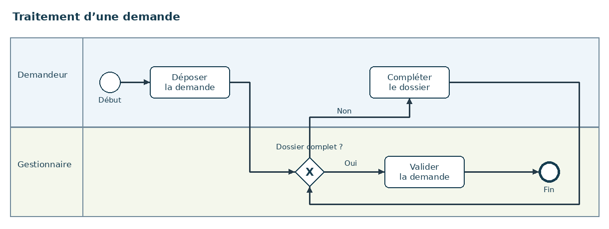
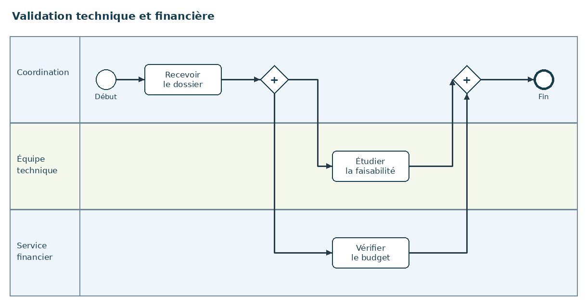

# Exemples illustrés et commandes à copier

Ces deux images BPMN synthétiques sont accompagnées d’un **JSON de référence préparé manuellement** et du Mermaid généré à partir de ce JSON. Les sorties sont des résultats attendus, pas des sorties obtenues par un modèle vision réel. Les commandes Ollama et OpenAI ci-dessous permettent de tester la reconnaissance et de la comparer à ces références.

Exécuter les commandes depuis la racine du dépôt après `pip install -e '.[ui]'`.

## 1. Demande : décision et boucle de complément

### Image source



### Résultat Mermaid de référence



Fichiers : [code Mermaid](demande/expected.mmd), [JSON de référence](demande/reference.json).

**Avec Ollama** (serveur local déjà lancé) :

```bash
ollama pull qwen3-vl:8b
bpmn-mermaid examples/demande/source.png --provider ollama --model qwen3-vl:8b --endpoint http://localhost:11434 --direction LR --html -o output/demande-ollama
```

**Avec OpenAI** (variable `OPENAI_API_KEY` déjà définie) :

```bash
bpmn-mermaid examples/demande/source.png --provider openai --model gpt-4.1 --endpoint https://api.openai.com/v1 --direction LR --html -o output/demande-openai
```

**Test sans modèle ni clé**, avec le JSON de référence :

```bash
bpmn-mermaid examples/demande/reference.json --from-json --direction LR --html -o output/demande-reference
```

À vérifier dans la reconnaissance : deux couloirs, six éléments, six flèches, sortie « Non » vers « Compléter le dossier », retour vers la passerelle et sortie « Oui » vers « Valider la demande ».

## 2. Validation : deux branches parallèles et synchronisation

### Image source



### Résultat Mermaid de référence



Fichiers : [code Mermaid](validation-parallele/expected.mmd), [JSON de référence](validation-parallele/reference.json).

**Avec Ollama** :

```bash
bpmn-mermaid examples/validation-parallele/source.png --provider ollama --model qwen3-vl:8b --endpoint http://localhost:11434 --direction LR --html -o output/parallele-ollama
```

**Avec OpenAI** :

```bash
bpmn-mermaid examples/validation-parallele/source.png --provider openai --model gpt-4.1 --endpoint https://api.openai.com/v1 --direction LR --html -o output/parallele-openai
```

**Test sans modèle ni clé** :

```bash
bpmn-mermaid examples/validation-parallele/reference.json --from-json --direction LR --html -o output/parallele-reference
```

À vérifier : trois couloirs, sept éléments, sept flèches, deux passerelles parallèles (`parallel`, symbole +). L’étude technique et la vérification budgétaire partent de la première passerelle et rejoignent la seconde avant la fin. Il ne s’agit pas d’une alternative exclusive.

## Ouvrir le HTML et corriger le résultat

Après la commande, ouvrir `diagram.html` dans le dossier de sortie, par double-clic ou avec :

| Système | Commande pour le premier exemple de référence |
|---|---|
| Linux | `xdg-open output/demande-reference/diagram.html` |
| Windows PowerShell | `Start-Process output/demande-reference/diagram.html` |
| macOS | `open output/demande-reference/diagram.html` |

La page contient Mermaid JS, le code modifiable et le JSON. Elle fonctionne hors connexion. Le bouton **Enregistrer cette page** conserve les modifications du code Mermaid dans un nouveau HTML. Le JSON affiché reste le modèle d’origine.

Pour corriger durablement une reconnaissance, éditer `output/demande-ollama/model.json`, puis :

```bash
bpmn-mermaid output/demande-ollama/model.json --from-json --direction LR --html -o output/demande-corrigee
```

## Paramètres utiles

| Paramètre | Usage |
|---|---|
| Premier argument | Chemin de l’image, ou du JSON avec `--from-json` |
| `--provider ollama` / `--provider openai` | Fournisseur de reconnaissance |
| `--model` | Nom d’un modèle avec vision et sortie JSON |
| `--endpoint` | URL de base ; `/api/chat` ou `/chat/completions` est ajouté automatiquement |
| `--direction LR` | Disposition générale de gauche à droite |
| `--direction TB` | Disposition générale de haut en bas |
| `--html` | Ajouter une page HTML autonome aux exports |
| `-o` | Dossier de sortie, créé au besoin |
| `--from-json` | Exporter un JSON corrigé sans appel au modèle |

La disposition Mermaid diffère de l’image BPMN : les sous-graphes représentent les couloirs, mais leur alignement n’est pas garanti. Comparer les rattachements et les liens, pas les coordonnées.

## Régénérer les images pédagogiques

Cette étape est facultative; les PNG sont déjà fournis. Pillow est requis uniquement pour reconstruire ces images :

```bash
pip install Pillow
python -m examples.build_examples
```

Sous Linux, le script utilise la police DejaVu Sans de `/usr/share/fonts/truetype/dejavu/`. Sur un autre système, adapter les chemins de police dans `build_examples.py`. Les SVG de résultat sont des rendus du code Mermaid, pas des images sources de reconnaissance.
