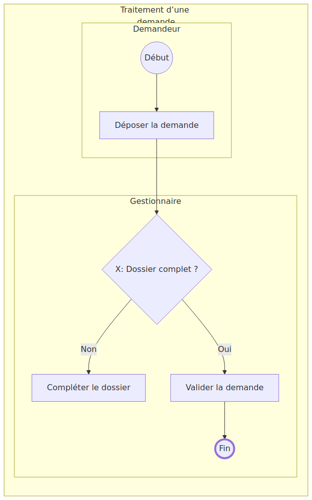
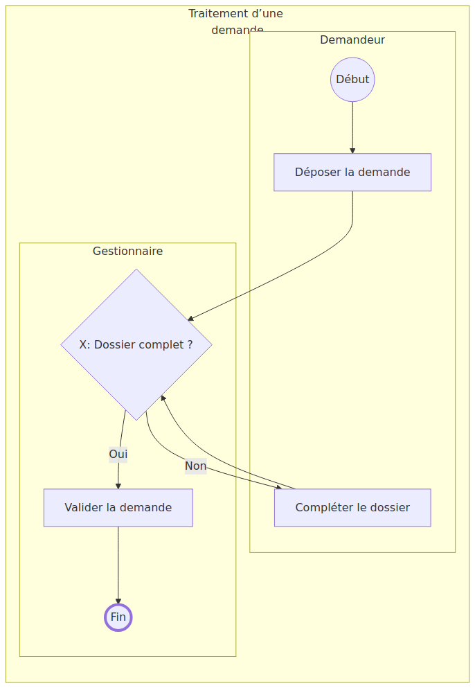
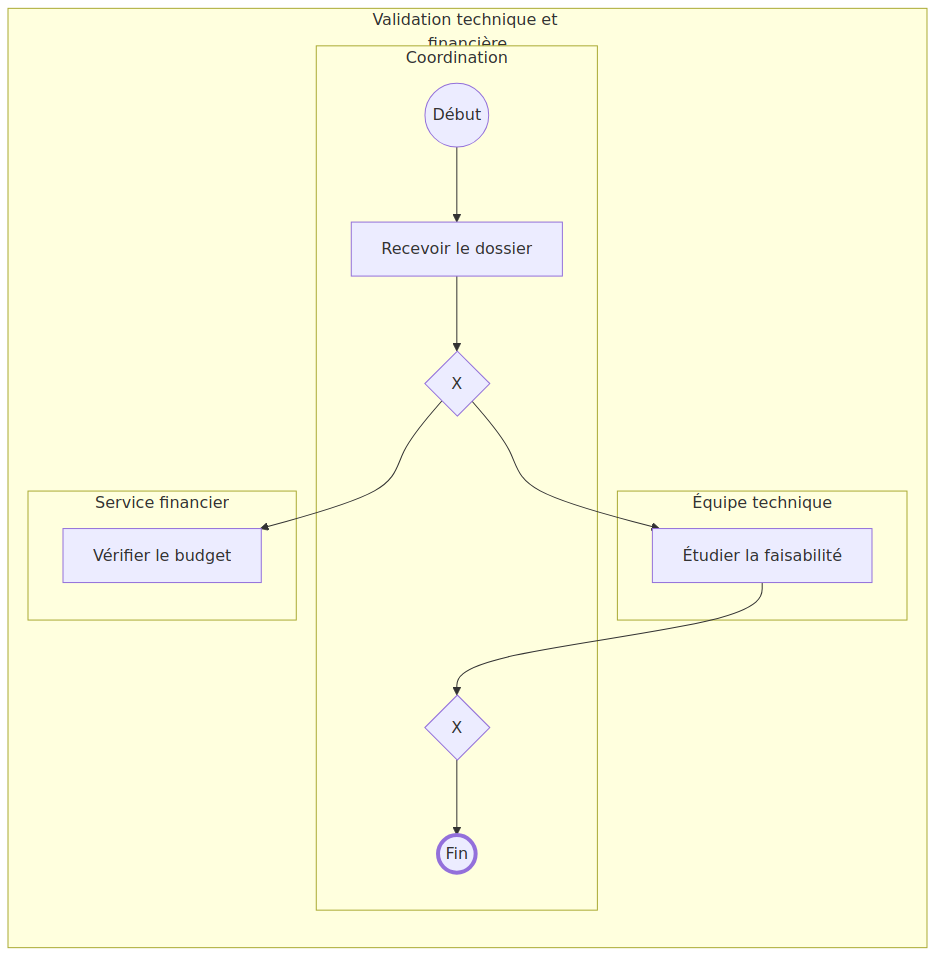
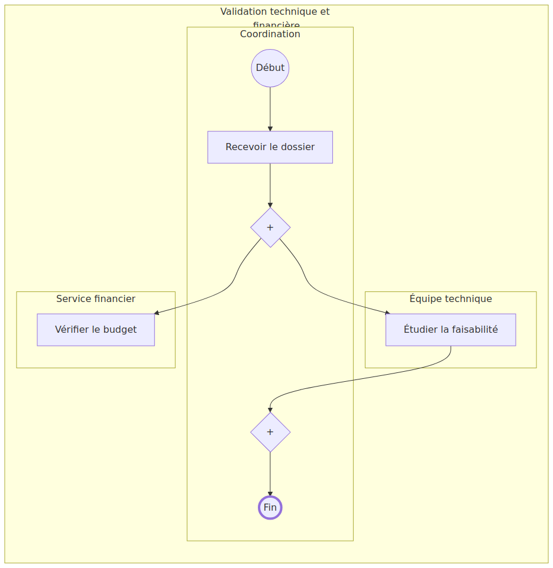
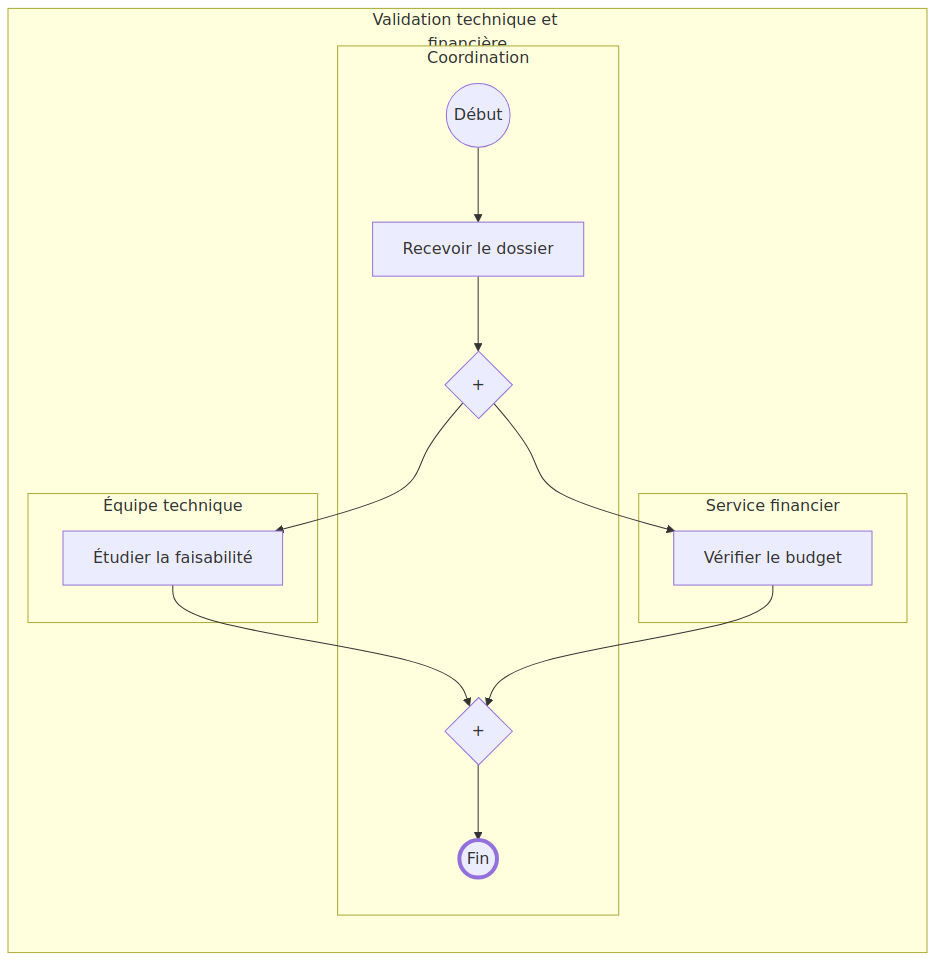

# Résultats de plusieurs itérations : avant / correction 1 / correction 2

**Nature de ces exemples : démonstrations scriptées, pas résultats d’un modèle vision réel.** Les défauts initiaux et les décisions de correction sont préparés manuellement. En revanche, chaque image de résultat est produite réellement par le moteur Mermaid embarqué dans Chromium, et le programme exécute la véritable boucle `refine`. Aucune clé API n’était disponible pour une évaluation avec OpenAI; ces exemples ne mesurent donc pas la qualité d’autocorrection d’un LLM.

Chaque cas comporte **quatre tours et six comparaisons scriptées** : deux tours appliquent des corrections, puis deux tours confirment un résultat inchangé. Les fichiers JSON, Mermaid, SVG et PNG de chaque version sont fournis, ainsi que les différences et les décisions.

## 1. Demande : corriger le couloir, puis restaurer la boucle

[Image BPMN originale](../demande/source.png)


| Version initiale erronée | Après le tour 1 | Après le tour 2 : résultat final |
|---|---|---|
|  |  |  |
| « Compléter le dossier » est dans Gestionnaire. Le retour vers la décision manque. | La tâche passe dans Demandeur. La boucle manque encore. | La flèche « Compléter le dossier → Dossier complet ? » est rétablie. |

Pour agrandir, ouvrir les images. Captures PNG : [initiale](demande/initial/diagram.png), [tour 1](demande/candidate-01/diagram.png), [finale](demande/candidate-02/diagram.png).

| Tour | Ajustement | Décision scriptée | État retenu |
|---|---|---|---|
| 1 | Changer `completer.lane` de `gestion` en `demandeur` | Candidate retenue après comparaison à trois images | 6 éléments, 5 flèches |
| 2 | Ajouter le flux `completer → complet` | Candidate retenue après comparaison à trois images | 6 éléments, 6 flèches |
| 3 | Aucun | Premier avis sans écart | Identique au tour 2 |
| 4 | Aucun | Deuxième avis sans écart, arrêt | Identique au tour 2 |

Pièces : [code initial](demande/initial/diagram.mmd), [code après le tour 1](demande/candidate-01/diagram.mmd), [code final](demande/candidate-02/diagram.mmd), [diff JSON du tour 1](demande/changes-01.diff), [diff JSON du tour 2](demande/changes-02.diff), [diff Mermaid du tour 1](demande/changes-01.mmd.diff), [diff Mermaid du tour 2](demande/changes-02.mmd.diff), [rapport des tours](demande/report.json), [provenance](demande/provenance.json).

**Exécuter avec votre véritable modèle Ollama** :

```bash
bpmn-mermaid examples/demande/source.png --provider ollama --model qwen3-vl:8b --refine --rounds 4 -o output/demande-iterations
```

**Isoler la correction visuelle en partant des mêmes erreurs**, sans nouvelle extraction initiale :

```bash
bpmn-mermaid examples/iterations/demande/initial/model.json --from-json --reference-image examples/demande/source.png --provider ollama --model qwen3-vl:8b --refine --rounds 4 -o output/demande-correction
```

## 2. Validation : rétablir le parallélisme, puis la synchronisation

[Image BPMN originale](../validation-parallele/source.png)


| Version initiale erronée | Après le tour 1 | Après le tour 2 : résultat final |
|---|---|---|
|  |  |  |
| Les losanges portent X au lieu de +. La branche financière ne rejoint pas la jonction. | Les deux passerelles redeviennent parallèles (+). | La branche financière rejoint la synchronisation avant la fin. |

Captures PNG : [initiale](validation-parallele/initial/diagram.png), [tour 1](validation-parallele/candidate-01/diagram.png), [finale](validation-parallele/candidate-02/diagram.png).

| Tour | Ajustement | Décision scriptée | État retenu |
|---|---|---|---|
| 1 | Passer `split.kind` et `join.kind` de `exclusive` à `parallel` | Candidate retenue | 7 éléments, 6 flèches |
| 2 | Ajouter le flux `budget → join` | Candidate retenue | 7 éléments, 7 flèches |
| 3 | Aucun | Premier avis sans écart | Identique au tour 2 |
| 4 | Aucun | Deuxième avis sans écart, arrêt | Identique au tour 2 |

Pièces : [code initial](validation-parallele/initial/diagram.mmd), [code après le tour 1](validation-parallele/candidate-01/diagram.mmd), [code final](validation-parallele/candidate-02/diagram.mmd), [diff JSON du tour 1](validation-parallele/changes-01.diff), [diff JSON du tour 2](validation-parallele/changes-02.diff), [diff Mermaid du tour 1](validation-parallele/changes-01.mmd.diff), [diff Mermaid du tour 2](validation-parallele/changes-02.mmd.diff), [rapport des tours](validation-parallele/report.json), [provenance](validation-parallele/provenance.json).

**Exécuter avec OpenAI**, après avoir défini `OPENAI_API_KEY` :

```bash
bpmn-mermaid examples/validation-parallele/source.png --provider openai --model gpt-4.1 --refine --rounds 4 -o output/parallele-iterations
```

Ou partir de la version comportant les défauts illustrés :

```bash
bpmn-mermaid examples/iterations/validation-parallele/initial/model.json --from-json --reference-image examples/validation-parallele/source.png --provider openai --model gpt-4.1 --refine --rounds 4 -o output/parallele-correction
```

Ces commandes appellent réellement le fournisseur; leurs corrections et leur nombre de tours peuvent différer de la démonstration scriptée. Avec quatre tours, le plafond est de dix appels avec extraction, ou neuf en partant d’un JSON. Aucun nombre de corrections n’est garanti.

## Ouvrir le résultat final et relire les tours

Les commandes réelles produisent `diagram.html`, `diagram.png`, `diagram.svg`, `diagram.mmd`, `model.json` et `refinement.json` dans le dossier de sortie.

```bash
# Linux
xdg-open output/demande-iterations/diagram.html
# Windows PowerShell
# Start-Process output/demande-iterations/diagram.html
# macOS
# open output/demande-iterations/diagram.html
```

Pour ouvrir le HTML de la **référence finale de cette démonstration**, sans appeler de fournisseur :

```bash
bpmn-mermaid examples/iterations/demande/candidate-02/model.json --from-json --html -o output/demo-final
```

Le dossier `refinement/` d’une exécution réelle contient les captures et avis de chaque passe. Dans les exemples versionnés, les HTML répétant le moteur JS de 2,7 Mo ne sont pas inclus; les autres pièces restent consultables directement sur GitHub.

## Reproduire exactement ces deux démonstrations, sans LLM

Installer les dépendances visuelles et le navigateur :

```bash
pip install -e '.[visual]'
python -m playwright install chromium
python -m examples.build_iterations
```

Le script injecte les erreurs connues, fournit les décisions préparées et génère à nouveau tous les rendus. Il vérifie que les deux corrections sont retenues, que les deux confirmations arrêtent la boucle et que le modèle final est strictement égal à la référence. Les étapes et leurs nombres d’images sont contrôlés. Le code ne réalise aucune requête vers un fournisseur vision.

Voir [le script](../build_iterations.py) et [le fonctionnement détaillé de la boucle](../../docs/visual-refinement.md).
